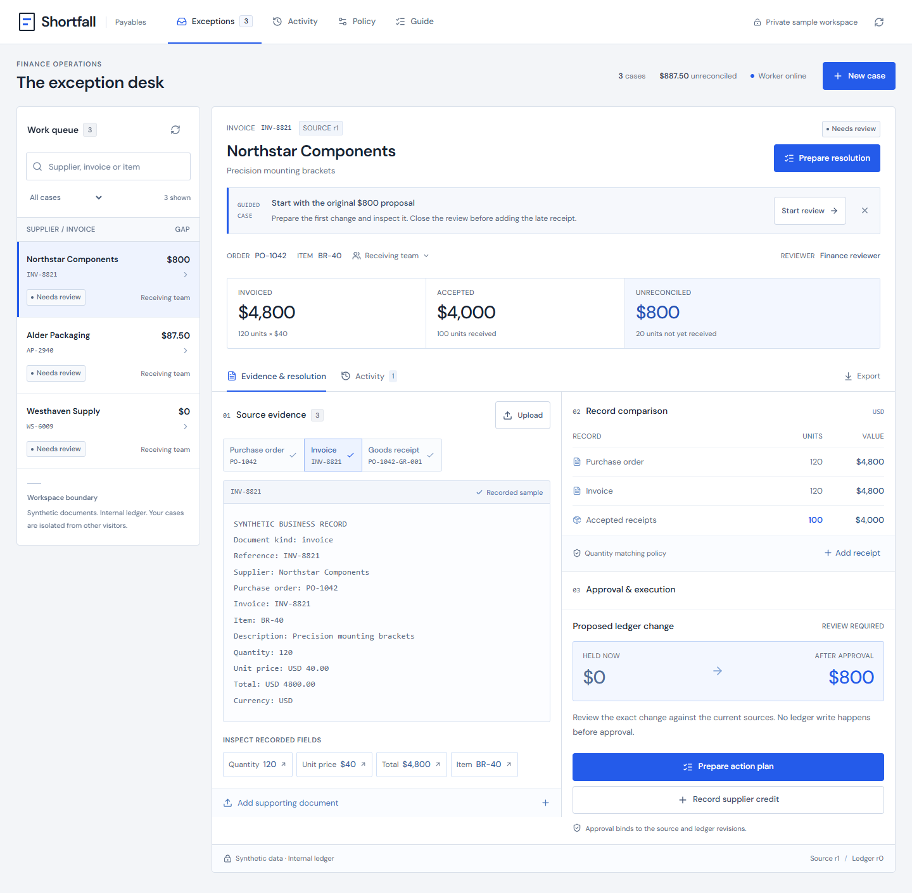

# Shortfall

Resolve invoices for goods that have not arrived. Shortfall gives finance and receiving staff one case workspace for source evidence, quantity discrepancies, approvals, internal holds, and supplier credits.

**Live demo:** [shortfall.95.179.254.189.sslip.io](https://shortfall.95.179.254.189.sslip.io). Public HTTPS, database/worker health, three API workflow checks, two browser checks, and live Claude Opus 5.5 receipt/credit extraction have passed on the Vultr deployment.

The application uses synthetic business records and an internal demonstration ledger. It does not send supplier messages, initiate payments, or update an ERP.

## The workflow

1. Open a case or create one with a supplier, purchase order, invoice, item, and accepted quantity.
2. Attach a supported document. The worker extracts fields and exact quotes; code checks the evidence, identifiers, currency, and arithmetic.
3. Review a proposed change. Approval binds to current evidence, policy, and ledger revisions.
4. The worker executes the approved change and records its result. Changed evidence invalidates an old approval; retrying an applied command does not duplicate it.
5. Import a matching supplier credit, approve the credit and hold-release correction, then export the reconciled case.

The first release supports one invoice per supplier/purchase-order pair, one item, whole units, USD, and an agreed unit price. Tax, freight, foreign exchange, split invoicing, scanned PDFs, and production accounting integrations require further work. Owner/reviewer names represent demo assignments, not authenticated enterprise roles.

## Try the sample

Open the application in a fresh browser and choose **Explore a sample case**. The guided case explains each next action. Choose **Create your own case** to enter an independent invoice; no account, API key, or installation is required. The **Guide** control reopens the entry instructions. [Judge quickstart](docs/submission/judge-quickstart.md)

Northstar Components invoices 120 units at $40: **$4,800**. The first receipt confirms 100 units, leaving an **$800** discrepancy. A later receipt adds 10 units. Shortfall rejects the previous $800 approval and proposes **$400** instead.

Approve the revised internal hold, then upload the supplied $400 credit note and approve reconciliation. The net invoice becomes **$4,400**; the purchase order still has **10 units outstanding**. The application records no payment. See the [four-minute demonstration](docs/demo.md) and samples under public/samples.

## How Vultr powers the application

Vultr Cloud Compute hosts the web application, API, PostgreSQL database, and Node worker. PostgreSQL stores cases, normalized document text, evidence spans, commands, audit history, jobs, and inference accounting. Caddy provides HTTPS. The worker calls Anthropic from the Vultr backend; the browser and web container receive no provider key.

~~~mermaid
flowchart LR
    Browser --> Caddy
    subgraph Vultr[Vultr Cloud Compute VM]
        Caddy[Caddy HTTPS] --> Web[Next.js web and API]
        Web --> DB[(PostgreSQL)]
        Worker[Node worker] --> DB
    end
    Worker --> Opus[Claude Opus 5.5]
    Web --> Export[JSON and CSV exports]
~~~

The custom PostgreSQL queue uses row locks, leases, retry limits, and persisted execution receipts. Approval and job creation share a transaction. Original upload bytes are hashed during intake; the prototype retains normalized text and evidence in PostgreSQL, not the original files. [Architecture](docs/architecture.md)

This entry targets [Challenge 02: Future of Work](https://lablab.ai/ai-hackathons/vultr-hackathon). Vultr runs the workflow backend and web deployment. Anthropic uses a separate API budget; Vultr Serverless Inference is optional for this track and is not used here.

## Run locally

Requirements: Node.js 24, npm, and Docker Compose for PostgreSQL. Use synthetic documents only.

~~~sh
npm ci
node scripts/init-local-env.mjs
docker compose --env-file .env.local -f compose.local.yaml up -d
npm run db:migrate
~~~

The initializer creates an ignored .env.local with a random database password and leaves an existing file unchanged. Copy .env.example to .env.worker.local if that file does not exist. Add your Anthropic key there and keep ANTHROPIC_MODEL=claude-opus-5-5. Set ANTHROPIC_WORKSPACE_ID only if your key needs an explicit workspace.

Start web and worker in separate terminals:

~~~sh
npm run dev
~~~

~~~sh
npm run worker
~~~

Open [localhost:3000](http://localhost:3000). Without an Anthropic key, the seeded/manual workflow remains available and extraction reports unavailable. The worker loads only DATABASE_URL from .env.local, then its private .env.worker.local; deployment environment variables take precedence.

## Deploy on Vultr

Use a VM with Docker Compose, a hostname resolving to it, and inbound HTTP/HTTPS access. Keep PostgreSQL private. Create an ignored server-side .env.production.local containing POSTGRES_PASSWORD, APP_ORIGIN=https://your-hostname, and SITE_HOST=your-hostname. Use a URL-safe database password. Transfer .env.worker.local separately from the source archive.

~~~sh
docker compose --env-file .env.production.local up -d --build
docker compose --env-file .env.production.local ps
~~~

Compose waits for PostgreSQL, runs the idempotent migration, starts web/worker, then Caddy. The image uses the full Node.js 24 runtime and installed dependencies: npm start serves Next.js and npm run worker starts the worker. The /api/health endpoint reports database availability and worker heartbeat.

The database volume preserved state across a tested container replacement. A queued hold survived restart and produced exactly one execution and one task. A pre-deployment dump restored into an isolated temporary database with nine tables, 34 cases, and seven budget reservations; the temporary database was removed without changing the application database. The backup helper is scripts/backup-database.sh; automated offsite backup remains outstanding. Do not run docker compose down -v on records you need. Infrastructure credentials in .env.deploy.local belong only to deployment tooling.

## Verification

~~~sh
npx next typegen --webpack
npm run typecheck
npm test
node --env-file=.env.local --import tsx --test tests/api.database.test.ts
npm run build
npm run test:e2e
~~~

Generate route types before typechecking a clean checkout. The database test needs running PostgreSQL. Browser tests need the application and worker; Microsoft Edge is the default browser, or set PLAYWRIGHT_BROWSER_CHANNEL=chromium after installing Playwright Chromium. TEST_BASE_URL can target another running deployment. Regular tests do not call the model; node scripts/smoke-inference.mjs deliberately uploads two samples and consumes API allowance.

The [CI workflow](.github/workflows/ci.yml) runs isolated PostgreSQL tests, route generation, typechecking, a production build, and Chromium workflows with inference disabled. The [first hosted run passed](https://github.com/Huzyefahwasim/vultr-hackathon/actions/runs/41763975019): 41 tests and five API/browser workflows.

The current regular suite contains **51 tests: 50 passed and one database test skipped** without database configuration. The database integration test **passed separately**, including competing reservations at the global/workspace ceilings. Full typechecking and formatting checks passed. The latest public run passed **three API workflow tests and two browser tests in 18.3 seconds**, including fresh own-case entry, the guide, persistence, isolation, and mobile behavior. Production build, restart/persistence, and isolated backup restoration passed. Live Opus extraction completed the $4,400 reconciliation and rejected the stale approval; an additional deployed CSV upload verified nine source spans and the expected $22.50 hold. [Workflow verification](docs/evaluation.md)

A captioned capture of the public workflow passed its checks. The final presentation adds synthesized narration and the measured evaluation; public MP4 and cover delivery remain pending verification. See the [demonstration and media status](docs/demo.md), [narration source and voice credits](docs/submission/media-notes.md), and [slide content and speaker notes](docs/submission/slide-content.md). The reusable recorder is scripts/record-demo.mjs; scripts/smoke-recovery.mjs supports prepare and verify phases for the restart check.

## Document evaluation

The frozen 24-document baseline accepted 9/12 supported documents exactly and sent three valid CSVs to review; all 12 challenge expectations passed. After a validator correction, three targeted reruns passed, followed by four fresh CSV cases with expected outcomes. These are project-authored synthetic records with no independent reviewer. The [full document evaluation](docs/evaluation-results.md) preserves the separate sets: 28 unique documents, 31 settled calls, and $0.474656.

## API budget

The worker uses claude-opus-5-5 with adaptive thinking, low effort, structured JSON, an 8,000-input-token limit, and a 2,000-output-token limit. It ignores thinking content and validates only extracted fields and evidence.

PostgreSQL reserves $0.09 per generation attempt. Admission stops before committed spend plus reservations would exceed **$40 globally** or **$1 per workspace**. A workspace has ten attempts; a job permits an initial attempt and one retry. Reset preserves accounting. These controls govern this application, not unrelated use of the provider account. [Inference details](docs/inference-budget.md)

## Project documents

- [Product and buyer hypothesis](docs/product.md)
- [Architecture](docs/architecture.md)
- [Demonstration script](docs/demo.md)
- [Evaluation](docs/evaluation.md)
- [Delivery and submission](docs/delivery-plan.md)
- [Model and budget](docs/inference-budget.md)
- [Judge quickstart](docs/submission/judge-quickstart.md)
- [Submission fields and media](docs/submission/entry.json)

Application code is licensed under the [MIT License](LICENSE). Font notices: [DM Sans](docs/licenses/dm-sans.txt) and [Instrument Serif](docs/licenses/instrument-serif.txt).
