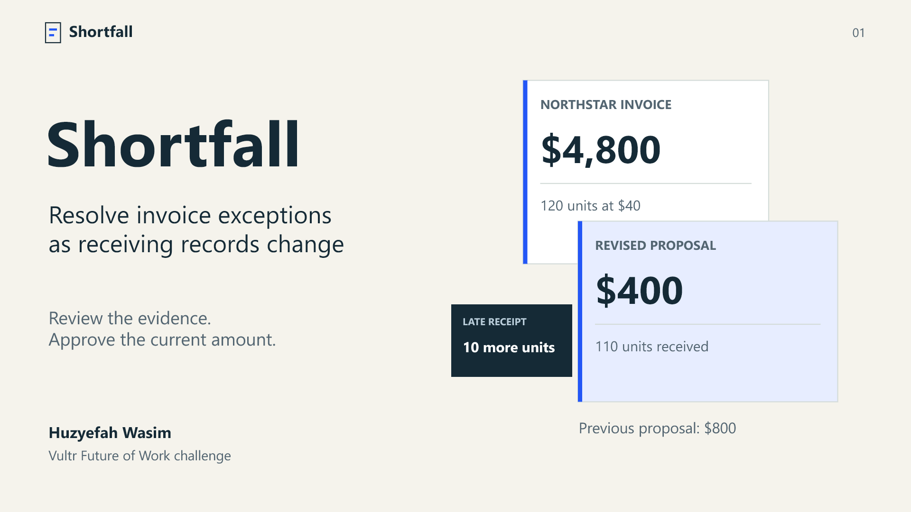

# Shortfall presentation

Eight slides for the Vultr Future of Work challenge, updated 6 November 2026.

- [Presentation PDF](shortfall-pitch.pdf): use this file for the LabLab slide upload.
- [Editable PowerPoint](shortfall-pitch.pptx): includes speaker notes and source references.
- [Narrated demonstration](https://shortfall.95.179.254.189.sslip.io/submission/): the recorded application workflow.
- [Spoken pitch](../../pitch.md) and [submission fields](../entry.json).

The deck explains the manual review work, the changed receipt and approval, supplier credit reconciliation, Vultr architecture, evaluation results, and proposed buyer. Expected time and financial benefits remain hypotheses to test with operators.

The PowerPoint uses Segoe UI with editable text, diagrams, and a comparison table. Product screenshots come from the deployed synthetic demonstration. The PDF embeds the presentation fonts for consistent viewing.

